<p align="center">
  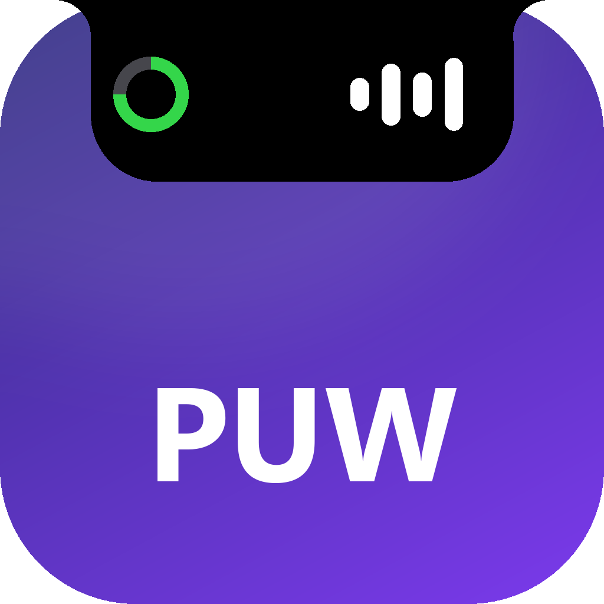
</p>

<h1 align="center">PUW Notch</h1>

<p align="center"><b>A notch that lives on your Windows.</b></p>

<p align="center">
  Music, tasks, notifications, weather and a tiny robot, tucked into the top edge of your screen, Dynamic Island style.<br>
  Rust + Direct2D drawn on the GPU through DirectComposition, ~770 KB exe, no WebView.
</p>

<p align="center"><a href="README.md">Tiếng Việt</a> · <b>English</b></p>

> **Download only from the author's source.** PUW Notch is published by its author (erikpuw) only at [github.com/erikpuw/puw_notch](https://github.com/erikpuw/puw_notch). A copy from anywhere else (file-sharing sites, other repositories, repackaged builds, files sent over the internet) is not controlled by the author and comes with no guarantee: it may have been modified or had code added. Use only the build in this repository's [Releases](https://github.com/erikpuw/puw_notch/releases).

## Features

| Feature | What it does |
|---|---|
| **Notch** | Clock, battery ring (green while charging, yellow in battery saver, red at 20 %), music waves. Hover to open the panel. Two looks, chosen in the tray: ears or a floating pill. |
| **Stays clear** | Shrinks when it would cover text underneath (many tabs, as in Edge or Terminal), hides during fullscreen games and videos. It asks the window beneath it (a bare bit of title bar, or a tab or button?) instead of capturing the screen, so it never has to hide from capture: it still shows in recordings, screen shares and remote desktop. |
| **Banners** | Windows notifications, volume, brightness, mic, Caps/Num Lock, Wi-Fi, Bluetooth (with the device's battery), network, battery, battery saver, USB. An × closes one early; a screenshot banner shows a thumbnail, click to open. |
| **Approve on the notch** | Questions from Claude Code, Codex and Antigravity (permission to use a tool, multiple-choice questions) show as banners; click **Allow** / **Deny** or pick an answer. No auto-approve; the banner closes by itself after 20 s (the app asks as usual) and at once when you answer in the app, and the tray switch turns it off. Setup [below](#setting-up-claude-code-optional). |
| **Robot** | After 30 s without input an LED face (just a pair of eyes) replaces the clock: it looks around, glances aside now and then, cheers once (green `> <` eyes, two sparkles) when the battery has just filled up, and is sad (red eyes, a blinking plug) at 20 % or less while not charging. Move the mouse and it shows `^ ^` and glances at the cursor; after 5 min it sleeps. Toggle in the tray. |
| **Light** | Loads only what is visible: lyrics while the Music page is open, icons while Notifications is open; paused while hidden for fullscreen. About 7 MB of RAM and 0 % CPU at rest, about 14 MB while music plays in the pill, about 22 MB with the Music page open and its aurora ([Task Manager pictures](#light-and-the-tray-menu)). |
| **Tray** | Minimal notch, Idle robot, Notch style, Pages shown (keep only the pages you use; a hidden page stops completely: no task, water or stand-up reminders, no Pomodoro, and no music, weather, limits or notifications are read), More features (Approve on the notch, Hide Windows volume popup: off by default), Start with Windows (asks for administrator permission once to create a `PuwNotch` task in Task Scheduler; from then on the notch starts with administrator rights 15 s after you sign in, with no prompt, and can read administrator windows too; untick it and the task is removed), Language (Tiếng Việt / English), About, Quit. |

**6 pages** (switch with ‹ ›, or put the mouse on the page dots: they open into a row of icons to pick a page at once, and come back as dots when the mouse leaves):

| Page | What it does |
|---|---|
| **Music** | Cover, synced lyrics (LRCLIB), ⏮ ⏯ ⏭, shuffle and repeat (off, all, one; green while on; only when the player has them: iTunes does, foobar2000 stays dim), drag the bar to seek (Windows media controls, iTunes, foobar2000). The lyrics button widens the panel; background and aurora follow the cover. |
| **Notes** | Notes and appointments in one list, a progress ring says how many are left. Type "Call 20:00", "Dentist 28/10 14:30", "Call mom tomorrow 9h". Overdue shows red "Late"; ⚙ picks a reminder 0–60 min ahead; edit and delete show under the mouse. |
| **Focus** | Pomodoro: the whole cycle (4 focus rounds of 25 min, short breaks of 5, a long one of 15) is one segmented strip, a big time, three chips to pick the mode, buttons to restart / start / go to the next segment. When a segment ends a banner says so and the next one starts by itself (after the long break it waits for a new cycle); while it runs the pill has a thin line along its bottom. |
| **Notifications** | The ~30 latest Windows notifications, each with its app icon and two lines; the count on the left; click to open the app; "Clear all" hides what is there (Windows keeps it). |
| **Health** | Water and stand-up reminders: a big figure, the day's progress as a bar, a round button to log a drink or having stood up; times and amounts under ⚙. |
| **Weather** | Type a city once: a large icon and temperature, the next 5 slots, feels-like, humidity, wind, the day's high, °C | °F. The sun button on the city line swaps the hours for **the sun's path** (sunrise, sunset, daylight left; the sun glows and glints now and then, a moon at night). Open-Meteo data, refreshed every 30 min. |
| **Limits** | 5-hour and weekly limits of Claude, Codex and Antigravity (a free plan: 30 days), a tab per app (with the app's dot), only for the apps found on the PC; Claude shows two concentric rings (5 hours outside, the week inside). Codex and Antigravity show what is left, Claude what is used. A banner warns at 80 %, 95 %, or 25 % of the limit in one day. |

The Limits page reads this PC only, nothing is sent:

| App | Read from |
|---|---|
| **Claude** | `plan-usage-history.json` that the desktop app writes itself (every ~15 min while the app fetches its numbers, no reset times; looked for in `%APPDATA%\Claude`, `Claude-Data` and the app's package folder; an old reading still shows with its age, open the usage popup in the app to refresh it); Claude Code in a terminal through `statusLine` |
| **Codex** | Session logs in `~/.codex`, updated after each agent turn; a reading over 10 min old says "Old"; after switching accounts it waits for the first turn |
| **Antigravity** | The app's own local server, only while it is open |

Credits: weather data [Open-Meteo](https://open-meteo.com) (CC BY 4.0), weather and battery icons [Lucide](https://lucide.dev) (ISC), banner icons [Tabler Icons](https://tabler.io/icons) (MIT).

## Screenshots

| Screenshot | Screenshot |
|---|---|
| 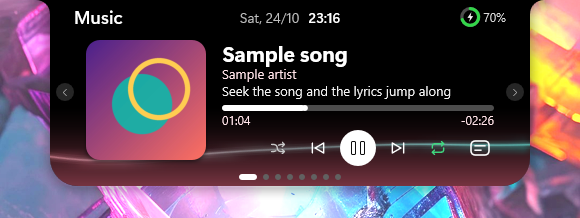<br>**Music**: cover, title, lyrics, background and aurora line in the cover's colours | 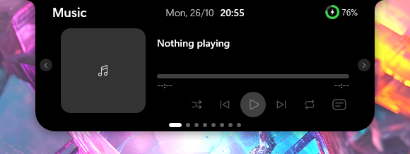<br>**Music** with nothing playing |
| 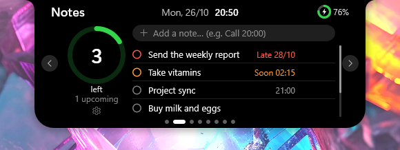<br>**Notes**: notes and appointments in one list | 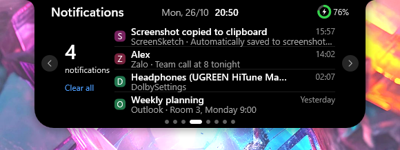<br>**Notifications**: each with its app's icon |
| 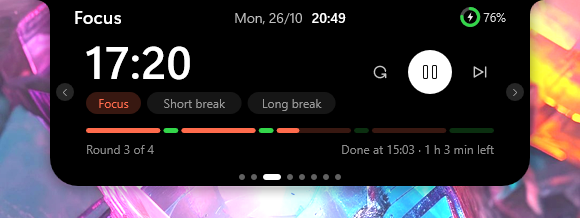<br>**Focus**: the whole Pomodoro cycle on one strip | <br>**Pill** while it counts: a thin line along its bottom, taking no room from music or weather |
| 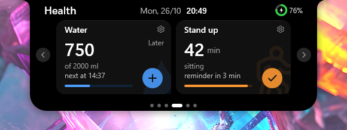<br>**Health**: water and stand-up reminders | <br>Notification **banner** |

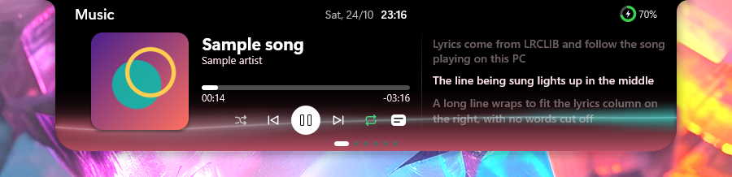<br>**Music** with lyrics: the panel widens, the line being sung lit in the middle, the aurora line swaying along the bottom

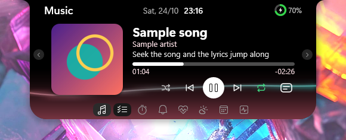<br>**Quick page picker**: put the mouse on the page dots and they open into a row of icons, click one to jump straight to that page (they come back as dots when the mouse leaves)

| 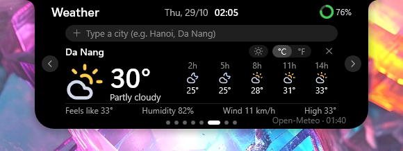<br>**Weather**: large icon, temperature, the next 5 slots, one line of figures, °C | °F buttons | 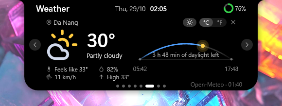<br>**The sun's path**: press the sun button, a blue arc from sunrise to sunset |
|---|---|

**Limits** of Claude, Codex and Antigravity (Claude shows what is used; Codex and Antigravity show what is left, counting down like their own apps). The Codex tab names the plan of the account in use; a free plan counts 30 days:

| Claude | Codex (free plan, 30 days) | Antigravity |
|---|---|---|
| 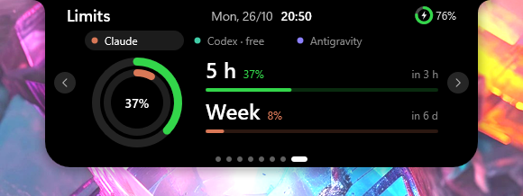 | 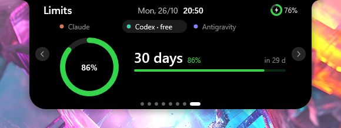 | 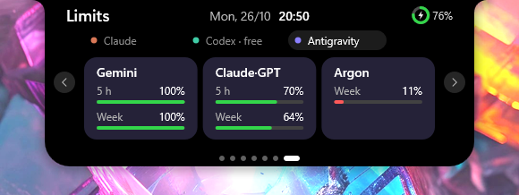 |

**Water and stand-up reminders**: the banner only informs (× closes it); to log a drink or that you stood up, press the round button on the Health page ("Later, 10 min" is there too):

| Time to drink | Goal reached | Sitting too long |
|---|---|---|
|  |  |  |

**Approve on the notch**: questions from Claude, Codex and Antigravity show as banners, a click answers:

| Claude (a multiple-choice question) | Antigravity (permission to use a tool) |
|---|---|
| 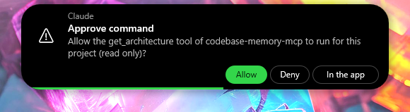 | 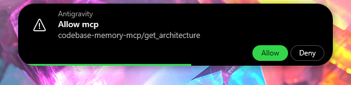 |

**Pill style** (tray, Notch style): floats below the top edge of the screen with all four corners round; the ears remain the default.

| Resting | Playing music | Open page |
|---|---|---|
|  |  | 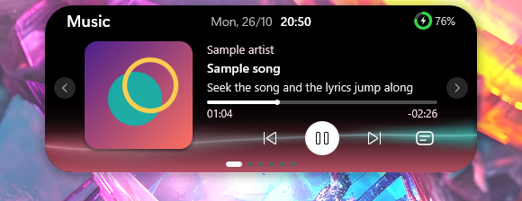 |

The collapsed pill:

| Music playing | Normal | Idle robot | Happy robot |
|---|---|---|---|
|  |  |  |  |

With the weather on:

| Normal | Music playing |
|---|---|
|  | 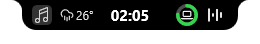 |

## Light and the tray menu

Task Manager in three states (measured on one PC, the figures vary by PC):

| The notch at rest | Music playing, as the pill | The Music page open, with the aurora |
|---|---|---|
| <br>0 % CPU, 7.3 MB of RAM | 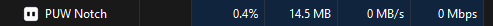<br>0.4 % CPU, 14.5 MB of RAM | <br>0.5 % CPU, 21.6 MB of RAM |

The tray menu (right-click the icon):

| Tiếng Việt | English |
|---|---|
| 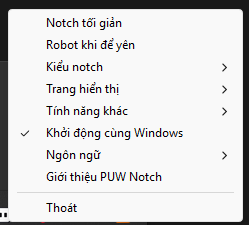 | 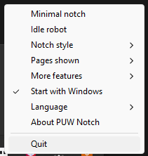 |

## Download and run

Get `puw_notch.exe` from [Releases](https://github.com/erikpuw/puw_notch/releases) and run it (download only from here, see the note at the top). The app is not code-signed, so nothing but this source confirms a file is the author's, and Windows may block it:

- **SmartScreen** ("Windows protected your PC"): click **More info** → **Run anyway**.
- **File marked as downloaded**: right-click the file → **Properties** → tick **Unblock** → OK.
- **Smart App Control** (Windows 11, shows "App blocked" with no way to continue): turn it off in Settings → Privacy & security → Windows Security → App & browser control → Smart App Control settings → **Off**. Once off it cannot be turned back on without reinstalling Windows, so think first. The alternative is to build from source (next section); a build made on your own machine usually runs.

## Build

```bash
cargo build --release
target/release/puw_notch.exe
```

The release build uses `opt-level = "z"` (smallest code first: an exe of ~770 KB instead of ~810 KB, with no measurable change in the time to draw a frame). `build.rs` embeds the icon and version info (VERSIONINFO: name, company, version taken from `Cargo.toml`) in the exe, shown under Properties → Details. Tests: `cargo test`. Settings live in `%APPDATA%\PuwNotch\`. Starts, exits, failures, self-hiding, the panel opening and closing, late frames, slow ticks and the GPU drawing the notch are logged to `%APPDATA%\PuwNotch\notch.log` (64 KB at most, started over when the version changes), to tell why a start with Windows did not come up.

Notifications are read from the Windows notification centre, so **Windows notifications must be on**. To see them only on the notch, with no banner in the screen corner, turn on Windows **Do not disturb** (Settings → System → Notifications). Windows still keeps the notifications in the notification centre, so the notch reads and shows them as usual. Windows does not let another app switch off per-app banners while running, so this is yours to turn on.

## Setting up Claude Code (optional)

Approving on the notch and the limits of Claude Code in a terminal need two small scripts from `tools/`. Copy them to `~/.claude/` and add this to `~/.claude/settings.json` (replace `<name>` with your Windows user name):

```json
"statusLine": { "type": "command", "command": "powershell -NoProfile -ExecutionPolicy Bypass -File C:/Users/<name>/.claude/puw-notch-statusline.ps1" },
"hooks": {
  "PermissionRequest": [
    { "matcher": "*", "hooks": [ { "type": "command", "command": "powershell -NoProfile -ExecutionPolicy Bypass -File C:/Users/<name>/.claude/puw-notch-approve.ps1", "timeout": 60 } ] }
  ]
}
```

- `puw-notch-approve.ps1` (hook): sends the permission request to the notch over a local pipe. If the notch is not running, nobody clicks within 50 seconds, or you press **In the app**, Claude asks as usual. There is no auto-approve.
- `puw-notch-statusline.ps1` (statusLine): only needed for Claude Code in a terminal; for the Claude desktop app the notch reads the app's own file.
- Antigravity needs no setup: the notch reads its local server (while it is open). Codex: the limits need no setup, approving commands is in the next section.

## Setting up Codex (optional)

The notch reads Codex's limits straight from `~/.codex`, no setup. **Approving Codex's commands on the notch** shares the `puw-notch-approve.ps1` script with Claude Code: copy it to `~/.claude/` (or wherever you like) and add a `PermissionRequest` entry to `~/.codex/hooks.json` (replace `<name>` with your Windows user name):

```json
{
  "hooks": {
    "PermissionRequest": [
      { "hooks": [ { "type": "command", "command": "powershell -NoProfile -ExecutionPolicy Bypass -File C:/Users/<name>/.claude/puw-notch-approve.ps1 -App Codex" } ] }
    ]
  }
}
```

- If `hooks.json` already has a `PermissionRequest` entry, add the group above at the **end** of its array so the older hooks keep their positions (Codex stores its trust hash by position).
- Codex only runs hooks it trusts: open Codex, type `/hooks` and trust the new hook.
- From then on, when Codex asks for permission, a **Codex** banner with the command shows on the notch; click **Allow** or **Deny**. If the notch is not running, or nobody clicks within 50 seconds, Codex asks as usual. There is no auto-approve.
- `-App` is the name on the banner. `-Log` (added at the end of the command) writes what the hook receives to `%TEMP%\puw-notch-hook.log`, only to see what an app sends; do not leave it on, as it stores the commands too.

## Support

If PUW Notch helps you, buy me a coffee ☕ [paypal.me/erikpuw](https://paypal.me/erikpuw)
