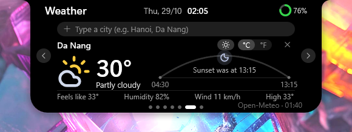
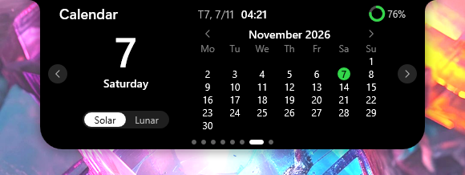
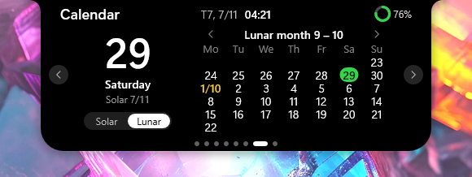
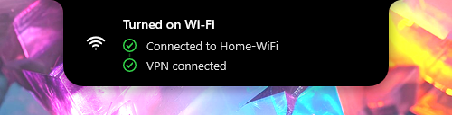
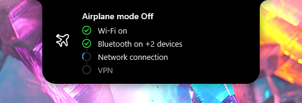
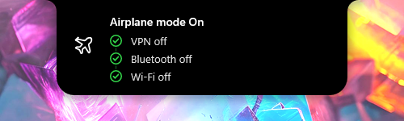
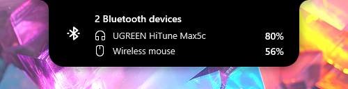

<p align="center">
  
</p>

<h1 align="center">PUW Notch</h1>

<p align="center"><b>A notch that lives on your Windows.</b></p>

<p align="center">
  Music, tasks, notifications, weather, a calendar and a tiny robot, tucked into the top edge of your screen, Dynamic Island style.<br>
  Written in Rust, ~906 KB exe, no WebView.
</p>

<p align="center"><a href="README.md">Tiếng Việt</a> · <b>English</b></p>

> **Download only from the author's source.** PUW Notch is published by its author (erikpuw) only at [github.com/erikpuw/puw_notch](https://github.com/erikpuw/puw_notch). A copy from anywhere else (file-sharing sites, other repositories, repackaged builds, files sent over the internet) is not controlled by the author and comes with no guarantee: it may have been modified or had code added. Use only the build in this repository's [Releases](https://github.com/erikpuw/puw_notch/releases).

## Features

| Feature | What it does |
|---|---|
| **Notch** | Clock, battery ring and music waves. Hover to open the panel. Two looks, chosen in the tray: ears or a floating pill. |
| **Stays clear** | Shrinks when it would cover text underneath, hides during fullscreen games and videos. It still shows in recordings and screen shares. |
| **Banners** | Windows notifications, volume, brightness, mic, Caps/Num Lock, battery, USB, Wi-Fi, Bluetooth, airplane mode. Notifications that arrive together show one after another. |
| **Network banners** | Wi-Fi, Bluetooth and airplane mode each have their own banner. When Wi-Fi comes on or airplane mode goes off, the banner lists each step (the connection, the VPN, Bluetooth devices) with a green tick when done. Switching off and on quickly keeps only the last state. |
| **Live tasks** | Progress of copying, deleting files, downloads and builds shows as a banner. Off by default, [details](#live-tasks). |
| **Approve on the notch** | Questions from Claude Code, Codex and Antigravity show as banners, click **Allow** / **Deny**. No auto-approve. Setup [below](#setting-up-claude-code-optional). |
| **Robot** | After 30 s without input a robot face replaces the clock: it cheers when the battery is full and is sad when it is low. Toggle in the tray. |
| **Light** | About 7 MB of RAM and 0 % CPU at rest, about 14 MB while music plays, about 22 MB with the Music page open ([Task Manager pictures](#light-and-the-tray-menu)). |
| **Tray** | Minimal notch, Idle robot, Notch style, Pages shown, More features, Start with Windows, Language, About, Quit. |

A page hidden in the tray stops completely.

**Start with Windows** asks for administrator permission once. From then on the notch starts after you sign in, administrator windows included. Untick it to turn it off.

**8 pages**, switched with ‹ › or by putting the mouse on the page dots: they open into a row of icons to pick a page at once.

| Page | What it does |
|---|---|
| **Music** | Cover, synced lyrics, playback controls, drag the bar to seek (Windows, iTunes, foobar2000). The lyrics button widens the panel; the background follows the cover. |
| **Notes** | Notes and appointments in one list. Type "Call 20:00" or "Dentist 28/10 14:30". Overdue shows red; ⚙ picks a reminder. |
| **Focus** | Pomodoro: the whole cycle (4 rounds of 25 min, breaks of 5 and 15) on one strip. When a segment ends a banner says so and the next one starts by itself. |
| **Notifications** | The ~30 latest Windows notifications, click to open the app. "Clear all" only hides them in the notch. |
| **Health** | Water and stand-up reminders, a round button to log them, settings under ⚙. |
| **Weather** | Type a city once: temperature, the next 5 slots on a curve with the chance of rain, feels like, humidity, wind, °C \| °F. The sun button switches to the sun's path. Open-Meteo data. |
| **Calendar** | One month, weeks from Monday, the picked day large on the left. No holidays. On a PC set to Vietnam, China, Hong Kong, Macao, Taiwan or Korea, a **Solar \| Lunar** choice shows the lunar calendar. |
| **Limits** | 5-hour and weekly limits of Claude, Codex and Antigravity, a tab per app, only for the apps on the PC. A banner warns at 80 % and 95 %. |

The Limits page reads this PC only and sends nothing: Claude from the file its desktop app writes (Claude Code in a terminal through `statusLine`), Codex from the session logs in `~/.codex`, Antigravity from the app itself while it is open.

Credits: weather data [Open-Meteo](https://open-meteo.com) (CC BY 4.0), weather and battery icons [Lucide](https://lucide.dev) (ISC), banner icons [Tabler Icons](https://tabler.io/icons) (MIT).

## Live tasks

Turn on in **tray → More features → Live tasks** (off by default). One task shows at a time, Explorer first, then downloads, then builds; with more running, the title gets a **+N**.

- **Explorer:** copying, moving, deleting and extracting, with the percent and a progress bar. It cannot catch an operation that is too quick or has no progress window.
- **Downloads:** the Downloads folder Windows is set to and the download folders of Edge, Chrome and Brave. Shows the file name, MB downloaded and MB/s; when it finishes, click the banner to open the folder. No percent, and Firefox is not supported yet.
- **Builds:** cargo, msbuild, dotnet, make, cmake, ninja and go run from a terminal. The end shows a green tick or a red ✕ by the exit code.

## Screenshots

| Screenshot | Screenshot |
|---|---|
| <br>**Music**: cover, title, lyrics, background and aurora line in the cover's colours | <br>**Music** with nothing playing |
| <br>**Notes**: notes and appointments in one list | <br>**Notifications**: each with its app's icon |
| <br>**Focus**: the whole Pomodoro cycle on one strip | <br>**Pill** while it counts: a thin line along its bottom |
| <br>**Health**: water and stand-up reminders | <br>Notification **banner** |

<br>**Music** with lyrics: the panel widens, the line being sung lit in the middle, the aurora line swaying along the bottom

<br>**Quick page picker**: put the mouse on the page dots and they open into a row of icons, click one to jump straight to that page

| <br>**Weather**: large icon, temperature, a curve over the next 5 slots with the chance of rain, a blue dot at the current hour, °C / °F buttons | <br>**By day**: a blue arc from sunrise to sunset, the sun standing at the time now | <br>**By night**: a crescent moon walks the arc from sunset to sunrise |
|---|---|---|

| <br>**Calendar**: the day large, weeks from Monday, ‹ › change the month | <br>**Lunar**: the Solar \| Lunar choice swaps the grid's numbers (only where the region has one) |
|---|---|

| <br>**Wi-Fi on**: the connection, then the VPN that was up before | <br>**Airplane mode off**: the steps are listed from the start and tick off as they happen |
|---|---|
| <br>**Airplane mode on**: Wi-Fi, Bluetooth and the VPN go off with it | <br>**Bluetooth**: two or more devices, a line each with its battery |

**Limits** of Claude, Codex and Antigravity. The Codex tab names the plan of the account in use; a free plan counts 30 days:

| Claude | Codex (free plan, 30 days) | Antigravity |
|---|---|---|
|  |  |  |

**Water and stand-up reminders**: the banner only informs (× closes it). To log a drink or that you stood up, press the round button on the Health page ("Later, 10 min" is there too):

| Time to drink | Goal reached | Sitting too long |
|---|---|---|
|  |  |  |

**Approve on the notch**: a click answers.

| Claude (a multiple-choice question) | Antigravity (permission to use a tool) |
|---|---|
|  |  |

**Pill style** (tray, Notch style): floats below the top edge of the screen with all four corners round. The ears remain the default.

| Resting | Playing music | Open page |
|---|---|---|
|  |  |  |

The collapsed pill:

| Music playing | Normal | Idle robot | Happy robot |
|---|---|---|---|
|  |  |  |  |

With the weather on:

| Normal | Music playing |
|---|---|
|  |  |

## Light and the tray menu

Task Manager in three states (measured on one PC, the figures vary by PC):

| The notch at rest | Music playing, as the pill | The Music page open, with the aurora |
|---|---|---|
| <br>0 % CPU, 7.3 MB of RAM | <br>0.4 % CPU, 14.5 MB of RAM | <br>0.5 % CPU, 21.6 MB of RAM |

The tray menu (right-click the icon):

| Tiếng Việt | English |
|---|---|
|  |  |

## Download and run

Get `puw_notch.exe` from [Releases](https://github.com/erikpuw/puw_notch/releases) and run it (download only from here, see the note at the top). The app is not code-signed, so nothing but this source confirms a file is the author's, and Windows may block it:

- **SmartScreen** ("Windows protected your PC"): click **More info** → **Run anyway**.
- **File marked as downloaded**: right-click the file → **Properties** → tick **Unblock** → OK.
- **Smart App Control** (Windows 11, shows "App blocked" with no way to continue): turn it off in Settings → Privacy & security → Windows Security → App & browser control → Smart App Control settings → **Off**. Once off it cannot be turned back on without reinstalling Windows. The alternative is to build from source.

## Build

```bash
cargo build --release
target/release/puw_notch.exe
```

Tests: `cargo test`. Settings live in `%APPDATA%\PuwNotch\`, with a log in `notch.log` beside them.

Notifications are read from the Windows notification centre, so Windows notifications must be on. To hide the banner in the screen corner, turn on **Do not disturb** (Settings → System → Notifications): the notch still shows them.

## Setting up Claude Code (optional)

Approving on the notch and the limits of Claude Code in a terminal need two small scripts from `tools/`. Copy them to `~/.claude/` and add this to `~/.claude/settings.json` (replace `<name>` with your Windows user name):

```json
"statusLine": { "type": "command", "command": "powershell -NoProfile -ExecutionPolicy Bypass -File C:/Users/<name>/.claude/puw-notch-statusline.ps1" },
"hooks": {
  "PermissionRequest": [
    { "matcher": "*", "hooks": [ { "type": "command", "command": "powershell -NoProfile -ExecutionPolicy Bypass -File C:/Users/<name>/.claude/puw-notch-approve.ps1", "timeout": 60 } ] }
  ]
}
```

- `puw-notch-approve.ps1` (hook): sends the permission request to the notch. If the notch is not running, nobody clicks within 50 seconds, or you press **In the app**, Claude asks as usual.
- `puw-notch-statusline.ps1` (statusLine): only needed for Claude Code in a terminal.
- Antigravity and Codex's limits need no setup. Approving Codex commands is in the next section.

## Setting up Codex (optional)

The notch reads Codex's limits straight from `~/.codex`, no setup. To **approve Codex's commands on the notch**, share the `puw-notch-approve.ps1` script with Claude Code: copy it to `~/.claude/` (or wherever you like) and add a `PermissionRequest` entry to `~/.codex/hooks.json` (replace `<name>` with your Windows user name):

```json
{
  "hooks": {
    "PermissionRequest": [
      { "hooks": [ { "type": "command", "command": "powershell -NoProfile -ExecutionPolicy Bypass -File C:/Users/<name>/.claude/puw-notch-approve.ps1 -App Codex" } ] }
    ]
  }
}
```

- If `hooks.json` already has a `PermissionRequest` entry, add the group above at the **end** of its array so the older hooks keep their positions.
- Codex only runs hooks it trusts: open Codex, type `/hooks` and trust the new hook.
- From then on, when Codex asks for permission, a **Codex** banner shows on the notch; click **Allow** or **Deny**. If the notch is not running, or nobody clicks within 50 seconds, Codex asks as usual.
- `-App` is the name on the banner. `-Log` writes what the hook receives to `%TEMP%\puw-notch-hook.log` to see what an app sends; do not leave it on, as it stores the commands too.

## Support

If PUW Notch helps you, buy me a coffee ☕ [paypal.me/erikpuw](https://paypal.me/erikpuw)
