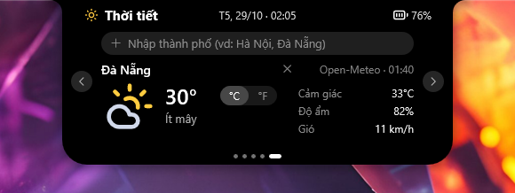
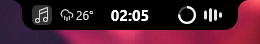

# PUW Notch

[Tiếng Việt](README.md) · **English**

A Dynamic Island–style notch for Windows. Rust + Direct2D drawn on the GPU through DirectComposition, ~664 KB exe, no WebView.

## Features

- **Notch**: clock, battery ring, music waves. Hover to open the panel. Shrinks when it would cover tabs or text underneath, hides during fullscreen games and videos.
- **5 pages** (switch with ‹ ›):
  - **Music**: cover art, synced lyrics (LRCLIB), ⏮ ⏯ ⏭, click to seek, a lyrics button widens the panel to show scrolling lyrics; background and aurora line follow the cover's colours. Works with any app using Windows media controls, plus iTunes and foobar2000.
  - **Tasks**: one list for tasks and appointments. Type "Buy milk", "Call 20:00", "Dentist 28/10 14:30", "Call mom tomorrow 9h". Tick / edit / delete; overdue shows red with "Late". ⚙ picks an early reminder of 0–60 min, plus one on time.
  - **Notifications**: the ~30 latest Windows notifications with app icons; click a row to open the app that sent it; smooth scrolling, and "Clear all" hides what is there (Windows keeps it).
  - **Health**: water and stand-up reminders with adjustable times and amounts.
  - **Weather**: type a city once (accents optional), the pill shows an icon and temperature; the page has a large icon, feels-like, humidity, wind. °C | °F follows Windows' region, click to switch. Refreshed every 30 minutes on a worker thread, "old" after 90 minutes; the × switches it off.
- **Banners**: Windows notifications, volume, brightness, mic, Caps/Num Lock, Wi-Fi, Bluetooth, network, battery, battery saver, USB plugged in / pulled out. Take a screenshot (Win+Shift+S) and the banner shows a thumbnail; click it to open the shot.
- **Idle robot**: after 30 s without input an LED face replaces the clock and changes expression; after 5 min it sleeps; when you are back it grins, then hands the pill back to the clock. Toggle in the tray.
- **Hide Windows volume popup** (tray, off by default): the app handles the volume keys itself, so only the notch shows. Laptop brightness and mic keys usually go through firmware and are not blocked.
- **Tray**: Minimal notch, Idle robot, Hide volume popup, Start with Windows, Language (Tiếng Việt / English), About, Quit.

Credits: weather data [Open-Meteo](https://open-meteo.com) (CC BY 4.0), weather icons [Lucide](https://lucide.dev) (ISC), banner icons [Tabler Icons](https://tabler.io/icons) (MIT).
## Screenshots

| | |
|---|---|
| <br>**Music**: cover, title, lyrics, background and aurora line in the cover's colours | <br>**Music** with nothing playing |
| <br>**Tasks**: tasks and appointments in one list | <br>**Notifications**: each with its app's icon |
| <br>**Health**: water and stand-up reminders | <br>Notification **banner** |

<br>**Music** with lyrics: the panel widens, the line being sung lit in the middle, the aurora line swaying along the bottom

<br>**Weather**: large icon, temperature, °C | °F buttons, feels-like, humidity, wind

The collapsed pill:

| Music playing | Normal | Idle robot | Happy robot |
|---|---|---|---|
|  |  |  |  |

With the weather on:

| Normal | Music playing |
|---|---|
|  |  |

## Download and run

Get `puw_notch.exe` from [Releases](https://github.com/erikpuw/puw_notch/releases) and run it. The app is not code-signed yet, so Windows may block it:

- **SmartScreen** ("Windows protected your PC"): click **More info** → **Run anyway**.
- **File marked as downloaded**: right-click the file → **Properties** → tick **Unblock** → OK.
- **Smart App Control** (Windows 11, shows "App blocked" with no way to continue): turn it off in Settings → Privacy & security → Windows Security → App & browser control → Smart App Control settings → **Off**. Once off it cannot be turned back on without reinstalling Windows, so think first. The alternative is to build from source (next section); a build made on your own machine usually runs.

## Build

```bash
cargo build --release
target/release/puw_notch.exe
```

Tests: `cargo test`. Settings live in `%APPDATA%\PuwNotch\`. Starts, exits, failures, self-hiding and the GPU drawing the notch are logged to `%APPDATA%\PuwNotch\notch.log` (64 KB at most), to tell why a start with Windows did not come up.

Notifications are read from the Windows notification centre, so **Windows notifications must be on**. To see them only on the notch, with no banner in the screen corner, turn on Windows **Do not disturb** (Settings → System → Notifications). Windows still keeps the notifications in the notification centre, so the notch reads and shows them as usual. Windows does not let another app switch off per-app banners while running, so this is yours to turn on.

## Support

If PUW Notch helps you, buy me a coffee ☕ [paypal.me/erikpuw](https://paypal.me/erikpuw)
