<p align="center">
  
</p>

<h1 align="center">PUW Notch</h1>

<p align="center"><b>Chiếc notch sống ngay trên Windows của bạn.</b></p>

<p align="center">
  Nhạc, việc, thông báo, thời tiết và một chú robot nhỏ, gói gọn ở mép trên màn hình theo kiểu Dynamic Island.<br>
  Rust + Direct2D vẽ trên GPU qua DirectComposition, exe ~735 KB, không WebView.
</p>

<p align="center"><b>Tiếng Việt</b> · <a href="README.en.md">English</a></p>

## Tính năng

| Tính năng | Làm gì |
|---|---|
| **Notch** | Giờ, vòng pin (xanh khi sạc, vàng khi tiết kiệm pin, đỏ từ 20%), sóng nhạc. Rê chuột để mở bảng. Hai kiểu chọn ở tray: tai thỏ hoặc viên thuốc nổi. |
| **Tự né** | Thu mini khi đè lên chữ bên dưới (nhiều tab như Edge, Terminal), ẩn khi chơi game hoặc xem phim toàn màn hình. Nó hỏi thẳng cửa sổ phía dưới (chỗ trống của thanh tiêu đề hay tab, nút) chứ không chụp màn hình, nên không phải giấu mình khỏi chụp: vẫn hiện khi quay, chia sẻ màn hình và điều khiển từ xa. |
| **Banner** | Thông báo Windows, âm lượng, độ sáng, mic, Caps/Num Lock, Wi-Fi, Bluetooth (kèm % pin thiết bị), mạng, pin, tiết kiệm pin, USB. Nút × tắt sớm; ảnh chụp màn hình có ảnh thu nhỏ, bấm để mở. |
| **Duyệt trên notch** | Câu hỏi của Claude Code và Antigravity (xin quyền dùng công cụ, câu hỏi chọn đáp án) hiện thành banner; bấm **Đồng ý** / **Không** hoặc chọn đáp án. Không tự duyệt; banner tự đóng sau 20 giây (app hỏi lại như thường) và đóng ngay khi bạn trả lời trong app, tắt hẳn ở tray. Cách thiết lập ở [dưới](#thiết-lập-cho-claude-code-tuỳ-chọn). |
| **Robot** | 30 giây không đụng máy thì mặt LED thay đồng hồ, 5 phút thì ngủ. Bật / tắt ở tray. |
| **Nhẹ** | Chỉ tải phần đang hiện: lời bài hát khi mở trang Nhạc, icon khi mở trang Thông báo; ẩn toàn màn hình thì ngừng tải. Khi nghỉ chỉ chừng 7 MB RAM và 0% CPU, đang phát nhạc ở dạng pill chừng 14 MB, mở trang Nhạc có aurora chừng 22 MB ([ảnh Task Manager](#nhẹ-và-menu-tray)). |
| **Tray** | Notch tối giản, Robot, Kiểu notch, Trang hiển thị (chỉ giữ trang bạn dùng; trang ẩn thì hoàn toàn ngừng: không nhắc việc, uống nước, đứng dậy, không đọc nhạc, thời tiết, hạn mức, thông báo), Tính năng khác (Duyệt ngay trên notch, Ẩn bảng âm lượng Windows: mặc định tắt), Khởi động cùng Windows, Ngôn ngữ (Tiếng Việt / English), Giới thiệu, Thoát. |

**6 trang** (chuyển bằng ‹ ›, hoặc rê chuột vào chấm trang: chấm mở thành hàng biểu tượng để chọn thẳng một trang, rời ra thì trả về chấm):

| Trang | Làm gì |
|---|---|
| **Nhạc** | Ảnh bìa, lời đồng bộ (LRCLIB), ⏮ ⏯ ⏭, kéo thanh để tua (Windows media controls, iTunes, foobar2000). Nút lời mở rộng bảng; nền và đường aurora theo màu bìa. |
| **Ghi chú** | Ghi chú và lịch hẹn trong một danh sách, vòng tiến độ cho biết còn bao nhiêu. Gõ "Họp 20:00", "Khám răng 28/10 14:30", "Gọi mẹ mai 9h". Quá giờ tô đỏ "Trễ"; ⚙ chọn nhắc trước 0–60 phút; nút sửa và xóa hiện khi rê chuột. |
| **Thông báo** | ~30 thông báo Windows gần nhất, mỗi tin có icon app và hai dòng; số lượng ở bên trái; bấm để mở app; "Xóa hết" ẩn những cái đã có (Windows vẫn giữ). |
| **Sức khỏe** | Nhắc uống nước và đứng dậy: số lớn, thanh tiến độ trong ngày, nút tròn để ghi một lần uống hoặc đã đứng dậy; chỉnh giờ và mức ở ⚙. |
| **Thời tiết** | Gõ tên thành phố một lần: icon và nhiệt độ lớn, 5 mốc giờ tới, cảm giác, độ ẩm, gió, nhiệt độ cao nhất, °C | °F. Dữ liệu Open-Meteo, làm mới 30 phút. |
| **Giới hạn** | Hạn mức 5 giờ và tuần của Claude, Codex, Antigravity (gói free: 30 ngày), mỗi app một tab (chấm màu của app), chỉ hiện app tìm thấy trên máy; Claude hiện hai vòng đồng tâm (5 giờ ngoài, tuần trong). Codex và Antigravity hiện phần còn lại, Claude phần đã dùng. Banner báo khi qua 80%, 95% hoặc dùng từ 25% trong một ngày. |

Trang Giới hạn chỉ đọc trên máy, không gửi đi đâu:

| App | Lấy từ |
|---|---|
| **Claude** | `plan-usage-history.json` do app desktop tự ghi (mỗi ~15 phút khi app đang lấy số, không có giờ làm mới; tìm trong `%APPDATA%\Claude`, `Claude-Data` và thư mục gói của app; số cũ vẫn hiện kèm tuổi, mở khung giới hạn trong app để làm mới); Claude Code ở terminal qua `statusLine` |
| **Codex** | Log phiên `~/.codex`, cập nhật sau mỗi lượt agent; số quá 10 phút ghi "Số cũ"; đổi tài khoản thì chờ lượt chạy đầu |
| **Antigravity** | Máy chủ cục bộ của chính app, chỉ khi app đang mở |

Ghi công: dữ liệu thời tiết [Open-Meteo](https://open-meteo.com) (CC BY 4.0), icon thời tiết và pin [Lucide](https://lucide.dev) (ISC), icon banner [Tabler Icons](https://tabler.io/icons) (MIT).

## Ảnh chụp

| | |
|---|---|
| 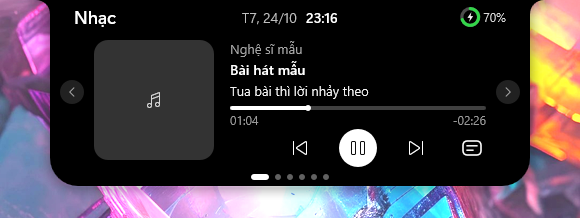<br>**Nhạc**: ảnh bìa, tên bài, lời, nền và đường aurora theo màu ảnh bìa | 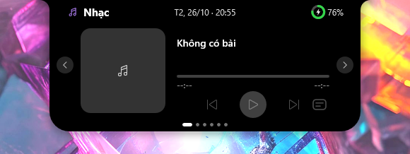<br>**Nhạc** khi chưa phát gì |
| 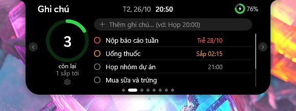<br>**Ghi chú**: ghi chú và lịch hẹn trong một danh sách | 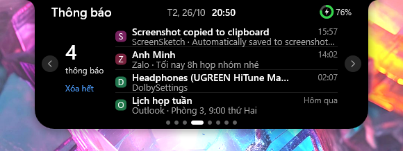<br>**Thông báo**: kèm icon của từng app |
| 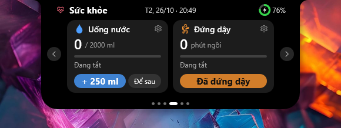<br>**Sức khỏe**: nhắc uống nước, đứng dậy | 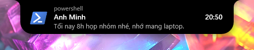<br>**Banner** thông báo |

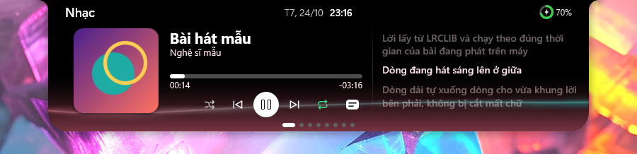<br>**Nhạc** với lời bài hát: bảng giãn ngang, dòng đang hát sáng ở giữa, đường aurora lượn dọc đáy bảng

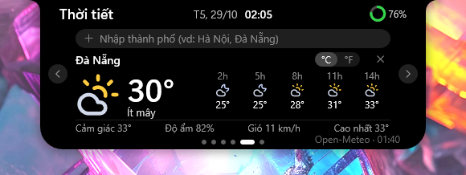<br>**Thời tiết**: icon lớn, nhiệt độ, 5 mốc giờ tới, một dòng số liệu, nút °C | °F

**Giới hạn** của Claude, Codex và Antigravity (Claude: phần đã dùng; Codex và Antigravity: phần còn lại, đếm lùi như chính app của chúng). Tab Codex ghi gói của tài khoản đang dùng, gói free tính theo 30 ngày:

| Claude | Codex (gói free, 30 ngày) | Antigravity |
|---|---|---|
| 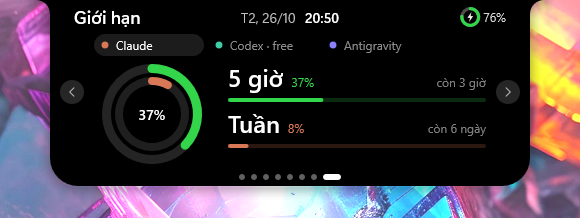 | 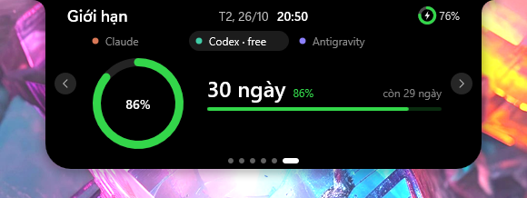 | 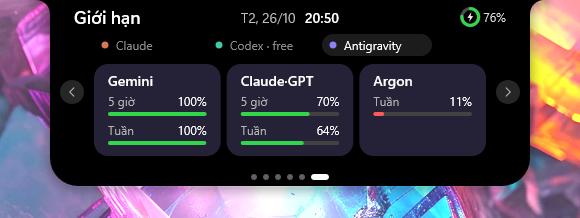 |

**Duyệt ngay trên notch**: câu hỏi của Claude và Antigravity hiện thành banner, bấm là trả lời:

| Claude (câu hỏi chọn) | Antigravity (xin quyền dùng công cụ) |
|---|---|
| 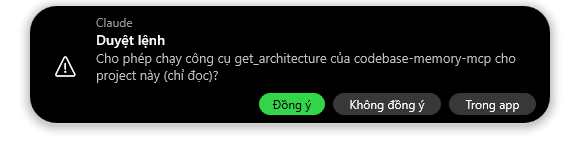 | 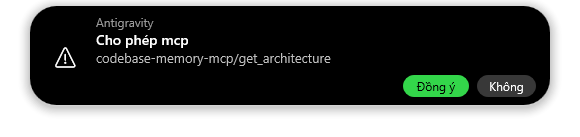 |

**Kiểu viên thuốc** (tray, Kiểu notch): nổi cách mép trên màn hình, bo tròn đủ bốn góc; mặc định vẫn là tai thỏ.

| Thu gọn | Đang phát nhạc | Trang mở rộng |
|---|---|---|
|  |  | 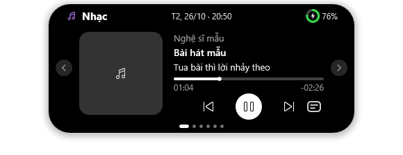 |

Viên thuốc thu gọn:

| Đang phát nhạc | Bình thường | Robot khi để yên | Robot vui |
|---|---|---|---|
|  |  |  |  |

Có thời tiết:

| Bình thường | Đang phát nhạc |
|---|---|
|  |  |

## Nhẹ và menu tray

Task Manager ở ba trạng thái (đo trên một máy, số thay đổi theo máy):

| Notch đang nghỉ | Phát nhạc, dạng pill | Mở trang Nhạc, có aurora |
|---|---|---|
| <br>0% CPU, 7,3 MB RAM | <br>0,4% CPU, 14,5 MB RAM | <br>0,5% CPU, 21,6 MB RAM |

Menu ở khay hệ thống (chuột phải vào biểu tượng):

| Tiếng Việt | English |
|---|---|
|  |  |

## Tải về và chạy

Tải `puw_notch.exe` ở mục [Releases](https://github.com/erikpuw/puw_notch/releases) rồi chạy. App chưa có chữ ký số nên Windows có thể chặn:

- **SmartScreen** ("Windows protected your PC"): bấm **More info** → **Run anyway**.
- **File bị đánh dấu tải từ mạng**: chuột phải vào file → **Properties** → tick **Unblock** → OK.
- **Smart App Control** (Windows 11, hiện "App blocked" và không có nút chạy tiếp): tắt ở Settings → Privacy & security → Windows Security → App & browser control → Smart App Control settings → **Off**. Tắt rồi không bật lại được nếu không cài lại Windows, nên cân nhắc. Cách khác là tự build từ mã nguồn (mục dưới), bản build trên máy mình thường chạy được.

## Build

```bash
cargo build --release
target/release/puw_notch.exe
```

Bản release dùng `opt-level = "z"` (ưu tiên nhỏ gọn: exe ~735 KB thay vì ~810 KB, thời gian vẽ mỗi khung hình đo được không đổi). `build.rs` gắn icon và thông tin phiên bản (VERSIONINFO: tên, công ty, version lấy từ `Cargo.toml`) vào exe, xem ở Properties → Details. Test: `cargo test`. Cài đặt lưu ở `%APPDATA%\PuwNotch\`. App ghi lúc khởi động, thoát, lỗi, lúc tự ẩn, lúc panel mở/đóng, khung hình trễ, nhịp chậm và GPU đang dùng để vẽ vào `%APPDATA%\PuwNotch\notch.log` (tối đa 64 KB, bắt đầu lại khi đổi phiên bản), để biết vì sao app không chạy khi khởi động cùng Windows.

Thông báo đọc từ trung tâm thông báo Windows, nên **thông báo Windows phải đang bật**. Muốn chỉ thấy thông báo trên notch, không hiện banner ở góc phải màn hình: bật **Không làm phiền** của Windows (Cài đặt → Hệ thống → Thông báo). Windows vẫn giữ thông báo trong trung tâm thông báo nên notch vẫn đọc và hiện banner như bình thường. Windows chưa cho app khác tự tắt banner của từng app đang chạy, nên việc này do bạn bật.

## Thiết lập cho Claude Code (tuỳ chọn)

Phần duyệt ngay trên notch và số giới hạn của Claude Code ở terminal cần hai script nhỏ trong `tools/`. Chép chúng vào `~/.claude/` rồi thêm vào `~/.claude/settings.json` (thay `<tên>` bằng tên người dùng Windows):

```json
"statusLine": { "type": "command", "command": "powershell -NoProfile -ExecutionPolicy Bypass -File C:/Users/<tên>/.claude/puw-notch-statusline.ps1" },
"hooks": {
  "PermissionRequest": [
    { "matcher": "*", "hooks": [ { "type": "command", "command": "powershell -NoProfile -ExecutionPolicy Bypass -File C:/Users/<tên>/.claude/puw-notch-approve.ps1", "timeout": 60 } ] }
  ]
}
```

- `puw-notch-approve.ps1` (hook): gửi yêu cầu duyệt tới notch qua ống cục bộ. Notch không chạy, không bấm trong 50 giây hoặc bấm **Trong app** thì Claude hỏi như bình thường. Không có tự duyệt.
- `puw-notch-statusline.ps1` (statusLine): chỉ cần nếu bạn dùng Claude Code ở terminal; app Claude desktop thì notch đọc thẳng file của app.
- Antigravity và Codex không cần thiết lập gì: notch đọc từ máy chủ cục bộ của Antigravity (khi app mở) và từ `~/.codex`.

## Ủng hộ

Nếu PUW Notch có ích, mời tôi một ly cà phê ☕ [paypal.me/erikpuw](https://paypal.me/erikpuw)
