<p align="center">
  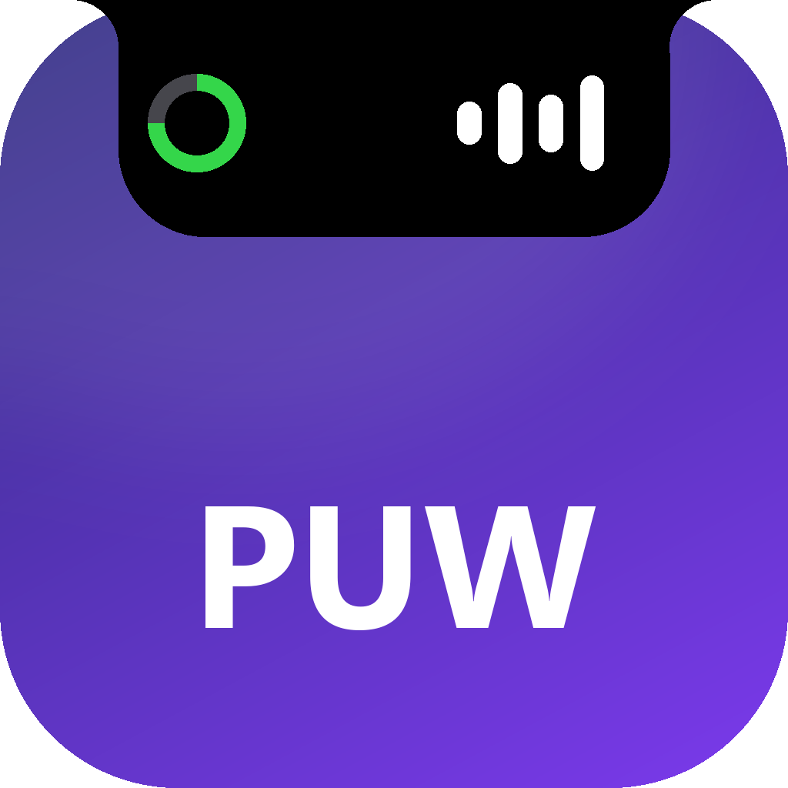
</p>

<h1 align="center">PUW Notch</h1>

<p align="center"><b>Chiếc notch sống ngay trên Windows của bạn.</b></p>

<p align="center">
  Nhạc, việc, thông báo, thời tiết, lịch và một chú robot nhỏ, gói gọn ở mép trên màn hình theo kiểu Dynamic Island.<br>
  Viết bằng Rust, exe ~906 KB, không WebView.
</p>

<p align="center"><b>Tiếng Việt</b> · <a href="README.en.md">English</a></p>

> **Chỉ tải từ nguồn của tác giả.** PUW Notch do tác giả (erikpuw) phát hành duy nhất tại [github.com/erikpuw/puw_notch](https://github.com/erikpuw/puw_notch). Bản tải từ nơi khác (trang chia sẻ, kho khác, bản đóng gói lại, tệp gửi qua mạng) không do tác giả kiểm soát và không được đảm bảo: có thể đã bị sửa đổi hoặc chèn thêm mã. Hãy chỉ dùng bản ở mục [Releases](https://github.com/erikpuw/puw_notch/releases) của kho này.

## Tính năng

| Tính năng | Làm gì |
|---|---|
| **Notch** | Giờ, vòng pin và sóng nhạc. Rê chuột để mở bảng. Hai kiểu, chọn ở tray: tai thỏ hoặc viên thuốc nổi. |
| **Tự né** | Thu mini khi đè lên chữ bên dưới, ẩn khi chơi game hoặc xem phim toàn màn hình. Vẫn hiện khi quay hoặc chia sẻ màn hình. |
| **Banner** | Thông báo Windows, âm lượng, độ sáng, mic, Caps/Num Lock, pin, USB, Wi-Fi, Bluetooth, máy bay. Nhiều thông báo đến cùng lúc thì hiện lần lượt. |
| **Banner mạng** | Wi-Fi, Bluetooth và máy bay mỗi thứ một banner. Wi-Fi bật hoặc máy bay tắt thì banner liệt kê từng bước (kết nối mạng, VPN, thiết bị Bluetooth), tích xanh khi xong. Bật tắt nhanh chỉ giữ trạng thái cuối. |
| **Tác vụ trực tiếp** | Tiến trình sao chép, xóa tệp, tải file và build hiện thành banner. Mặc định tắt, [chi tiết](#tác-vụ-nền-trực-tiếp). |
| **Duyệt trên notch** | Câu hỏi của Claude Code, Codex và Antigravity hiện thành banner, bấm **Đồng ý** / **Không**. Không tự duyệt. [Cách thiết lập](#thiết-lập-cho-claude-code-tuỳ-chọn). |
| **Robot** | 30 giây không đụng máy thì mặt robot thay đồng hồ: mừng khi pin đầy, buồn khi pin yếu. Bật / tắt ở tray. |
| **Nhẹ** | Khi nghỉ chừng 7 MB RAM và 0% CPU, phát nhạc chừng 14 MB, mở trang Nhạc chừng 22 MB ([ảnh Task Manager](#nhẹ-và-menu-tray)). |
| **Tray** | Notch tối giản, Robot, Kiểu notch, Trang hiển thị, Tính năng khác, Khởi động cùng Windows, Ngôn ngữ, Giới thiệu, Thoát. |

Trang ẩn ở tray thì ngừng hẳn.

**Khởi động cùng Windows** hỏi quyền quản trị khi bật. Task mở notch qua Windows Shell sau khi đăng nhập 15 giây, hỗ trợ cả bản ký số có `uiAccess`. Nếu task được tạo bằng bản cũ, tắt rồi bật lại tùy chọn sau khi cập nhật. Bỏ tick thì tắt.

**8 trang**, chuyển bằng ‹ › hoặc rê chuột vào chấm trang: chấm mở thành hàng biểu tượng để chọn thẳng một trang.

| Trang | Làm gì |
|---|---|
| **Nhạc** | Ảnh bìa, lời đồng bộ, điều khiển phát, kéo thanh để tua (Windows, iTunes, foobar2000). Nút lời mở rộng bảng; nền theo màu bìa. |
| **Ghi chú** | Ghi chú và lịch hẹn trong một danh sách. Gõ "Họp 20:00" hay "Khám răng 28/10 14:30". Quá giờ tô đỏ; ⚙ chọn nhắc trước. |
| **Tập trung** | Pomodoro: cả chu kỳ (4 vòng 25 phút, nghỉ 5 và 15) trên một thanh. Hết đoạn thì banner báo và đoạn kế tự chạy. |
| **Thông báo** | ~30 thông báo Windows gần nhất, bấm để mở app. "Xóa hết" chỉ ẩn trong notch. |
| **Sức khỏe** | Nhắc uống nước và đứng dậy, nút tròn để ghi nhận, chỉnh ở ⚙. |
| **Thời tiết** | Gõ tên thành phố một lần: nhiệt độ, 5 mốc giờ tới trên một đường cong kèm khả năng mưa, cảm giác, độ ẩm, gió, °C \| °F. Nút mặt trời đổi sang đường đi của mặt trời. Dữ liệu Open-Meteo. |
| **Lịch** | Một tháng, tuần từ thứ Hai, ngày chọn hiện lớn bên trái. Không có ngày lễ. Ở máy đặt vùng Việt Nam, Trung Quốc, Hồng Kông, Ma Cao, Đài Loan hoặc Hàn Quốc có nút **Dương \| Âm** để xem âm lịch. |
| **Giới hạn** | Hạn mức 5 giờ và tuần của Claude, Codex, Antigravity, mỗi app một tab, chỉ hiện app có trên máy. Banner báo khi qua 80% và 95%. |

Trang Giới hạn chỉ đọc dữ liệu trên máy, không gửi đi đâu: Claude đọc file do app desktop ghi (Claude Code ở terminal qua `statusLine`), Codex đọc log phiên trong `~/.codex`, Antigravity hỏi chính app khi nó đang mở.

Ghi công: dữ liệu thời tiết [Open-Meteo](https://open-meteo.com) (CC BY 4.0), icon thời tiết và pin [Lucide](https://lucide.dev) (ISC), icon banner [Tabler Icons](https://tabler.io/icons) (MIT).

## Tác vụ nền trực tiếp

Bật ở **tray → Tính năng khác → Tác vụ nền trực tiếp** (mặc định tắt). Mỗi lần hiện một tác vụ, ưu tiên Explorer, rồi tải file, rồi build; còn tác vụ khác thì tiêu đề có thêm **+N**.

- **Explorer:** sao chép, di chuyển, xóa và giải nén, kèm phần trăm và thanh tiến trình. Không bắt được thao tác quá nhanh hoặc không có cửa sổ tiến trình.
- **Tải file:** thư mục Downloads của Windows và thư mục tải của Edge, Chrome, Brave. Hiện tên file, MB đã tải và MB/s; tải xong bấm banner để mở thư mục. Không có phần trăm, chưa hỗ trợ Firefox.
- **Build:** cargo, msbuild, dotnet, make, cmake, ninja, go chạy từ terminal. Kết thúc báo dấu tích xanh hoặc dấu ✕ đỏ theo mã thoát.

## Ảnh chụp

| Ảnh chụp | Ảnh chụp |
|---|---|
| <br>**Nhạc**: ảnh bìa, tên bài, lời, nền và đường aurora theo màu bìa | <br>**Nhạc** khi chưa phát gì |
| <br>**Ghi chú**: ghi chú và lịch hẹn trong một danh sách | <br>**Thông báo**: kèm icon của từng app |
| 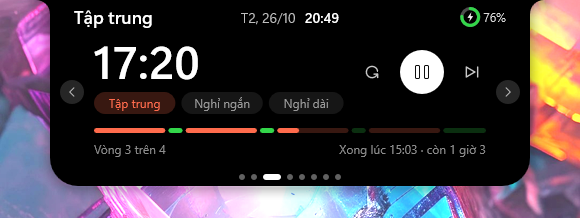<br>**Tập trung**: cả chu kỳ Pomodoro trên một thanh | <br>**Pill** khi đang đếm: một vạch mỏng ở đáy |
| <br>**Sức khỏe**: nhắc uống nước, đứng dậy | <br>**Banner** thông báo |

<br>**Nhạc** với lời bài hát: bảng giãn ngang, dòng đang hát sáng ở giữa, đường aurora lượn dọc đáy bảng

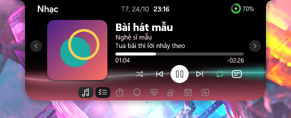<br>**Chọn trang nhanh**: rê chuột vào chấm trang, chấm mở thành hàng biểu tượng, bấm một biểu tượng để sang thẳng trang đó

| <br>**Thời tiết**: icon lớn, nhiệt độ, đường cong 5 mốc giờ tới kèm khả năng mưa, chấm xanh ở giờ hiện tại, nút °C / °F | 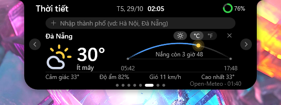<br>**Ban ngày**: cung xanh từ lúc mọc đến lặn, mặt trời đứng đúng giờ hiện tại | 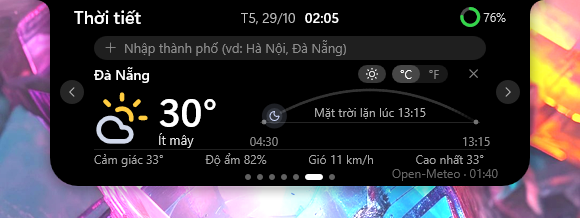<br>**Ban đêm**: trăng khuyết đi dọc cung từ lúc lặn đến lúc mọc |
|---|---|---|

| 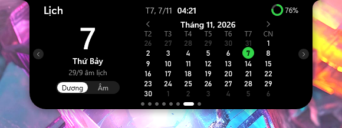<br>**Lịch**: ngày lớn, tuần từ thứ Hai, ‹ › đổi tháng | 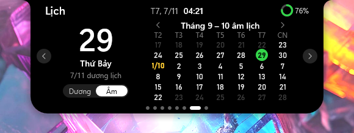<br>**Âm lịch**: nút Dương \| Âm đổi số trên lưới (chỉ ở vùng có âm lịch) |
|---|---|

| 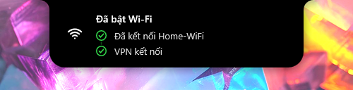<br>**Bật Wi-Fi**: kết nối mạng, rồi VPN đã chạy trước đó | 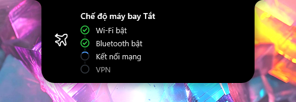<br>**Tắt chế độ máy bay**: các bước hiện sẵn, tích dần khi xong |
|---|---|
| 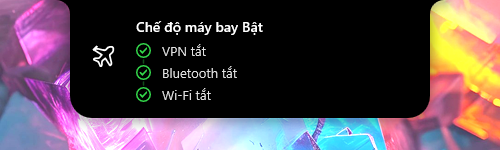<br>**Bật chế độ máy bay**: Wi-Fi, Bluetooth, VPN tắt theo | 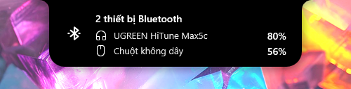<br>**Bluetooth**: hai thiết bị trở lên, mỗi thiết bị một dòng kèm pin |

**Giới hạn** của Claude, Codex và Antigravity. Tab Codex ghi gói của tài khoản đang dùng, gói free tính theo 30 ngày:

| Claude | Codex (gói free, 30 ngày) | Antigravity |
|---|---|---|
|  |  |  |

**Nhắc uống nước và đứng dậy**: banner chỉ báo (nút × để đóng). Để ghi nhận thì bấm nút tròn ở trang Sức khỏe (có sẵn "Để sau 10 phút"):

| Đến giờ uống | Đạt mục tiêu | Ngồi lâu |
|---|---|---|
|  |  |  |

**Duyệt ngay trên notch**: bấm là trả lời.

| Claude (câu hỏi chọn) | Antigravity (xin quyền dùng công cụ) |
|---|---|
|  |  |

**Kiểu viên thuốc** (tray, Kiểu notch): nổi cách mép trên màn hình, bo tròn đủ bốn góc. Mặc định vẫn là tai thỏ.

| Thu gọn | Đang phát nhạc | Trang mở rộng |
|---|---|---|
|  |  |  |

Viên thuốc thu gọn:

| Đang phát nhạc | Bình thường | Robot khi để yên | Robot vui |
|---|---|---|---|
|  |  |  |  |

Có thời tiết:

| Bình thường | Đang phát nhạc |
|---|---|
|  | 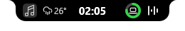 |

## Nhẹ và menu tray

Task Manager ở ba trạng thái (đo trên một máy, số thay đổi theo máy):

| Notch đang nghỉ | Phát nhạc, dạng pill | Mở trang Nhạc, có aurora |
|---|---|---|
| <br>0% CPU, 7,3 MB RAM | 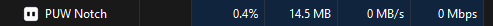<br>0,4% CPU, 14,5 MB RAM | <br>0,5% CPU, 21,6 MB RAM |

Menu ở khay hệ thống (chuột phải vào biểu tượng):

| Tiếng Việt | English |
|---|---|
| 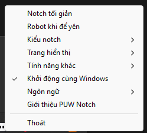 | 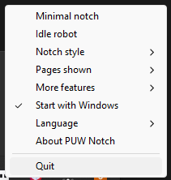 |

## Tải về và chạy

Tải `puw_notch.exe` ở mục [Releases](https://github.com/erikpuw/puw_notch/releases) rồi chạy (chỉ tải ở đây, xem lưu ý ở đầu trang). App chưa có chữ ký số, nên không có gì khác ngoài nguồn này để xác nhận file là của tác giả, và Windows có thể chặn:

- **SmartScreen** ("Windows protected your PC"): bấm **More info** → **Run anyway**.
- **File bị đánh dấu tải từ mạng**: chuột phải vào file → **Properties** → tick **Unblock** → OK.
- **Smart App Control** (Windows 11, hiện "App blocked" và không có nút chạy tiếp): tắt ở Settings → Privacy & security → Windows Security → App & browser control → Smart App Control settings → **Off**. Tắt rồi không bật lại được nếu không cài lại Windows. Cách khác là tự build từ mã nguồn.

## Build

```bash
cargo build --release
target/release/puw_notch.exe
```

Test: `cargo test`. Cài đặt lưu ở `%APPDATA%\PuwNotch\`, nhật ký ở `notch.log` cùng thư mục.

Thông báo đọc từ trung tâm thông báo Windows, nên phải bật thông báo Windows. Muốn không hiện banner ở góc phải màn hình, bật **Không làm phiền** (Cài đặt → Hệ thống → Thông báo): notch vẫn hiện như thường.

## Thiết lập cho Claude Code (tuỳ chọn)

Phần duyệt ngay trên notch và số giới hạn của Claude Code ở terminal cần hai script nhỏ trong `tools/`. Chép chúng vào `~/.claude/` rồi thêm vào `~/.claude/settings.json` (thay `<tên>` bằng tên người dùng Windows):

```json
"statusLine": { "type": "command", "command": "powershell -NoProfile -ExecutionPolicy Bypass -File C:/Users/<tên>/.claude/puw-notch-statusline.ps1" },
"hooks": {
  "PermissionRequest": [
    { "matcher": "*", "hooks": [ { "type": "command", "command": "powershell -NoProfile -ExecutionPolicy Bypass -File C:/Users/<tên>/.claude/puw-notch-approve.ps1", "timeout": 60 } ] }
  ]
}
```

- `puw-notch-approve.ps1` (hook): gửi yêu cầu duyệt tới notch. Notch không chạy, không bấm trong 50 giây hoặc bấm **Trong app** thì Claude hỏi như bình thường.
- `puw-notch-statusline.ps1` (statusLine): chỉ cần khi dùng Claude Code ở terminal.
- Antigravity và hạn mức của Codex không cần thiết lập. Duyệt lệnh Codex xem phần dưới.

## Thiết lập cho Codex (tuỳ chọn)

Hạn mức của Codex notch đọc thẳng từ `~/.codex`, không cần thiết lập. Để **duyệt lệnh của Codex ngay trên notch**, dùng chung script `puw-notch-approve.ps1` với Claude Code: chép nó vào `~/.claude/` (hoặc chỗ bạn thích) rồi thêm một mục `PermissionRequest` vào `~/.codex/hooks.json` (thay `<tên>` bằng tên người dùng Windows):

```json
{
  "hooks": {
    "PermissionRequest": [
      { "hooks": [ { "type": "command", "command": "powershell -NoProfile -ExecutionPolicy Bypass -File C:/Users/<tên>/.claude/puw-notch-approve.ps1 -App Codex" } ] }
    ]
  }
}
```

- Nếu `hooks.json` đã có mục `PermissionRequest`, thêm nhóm trên vào **cuối** mảng để không đổi vị trí các hook cũ.
- Codex chỉ chạy hook đã được tin cậy: mở Codex, gõ `/hooks` và tin cậy hook mới.
- Từ đó khi Codex xin quyền, banner **Codex** hiện trên notch; bấm **Đồng ý** hoặc **Không**. Notch không chạy hoặc không bấm trong 50 giây thì Codex hỏi như bình thường.
- `-App` là tên hiện trên banner. `-Log` ghi những gì hook nhận vào `%TEMP%\puw-notch-hook.log` để xem một app gửi gì; đừng để bật thường xuyên vì nó lưu cả lệnh.

## Ủng hộ

Nếu PUW Notch có ích, mời tôi một ly cà phê ☕ [paypal.me/erikpuw](https://paypal.me/erikpuw)
