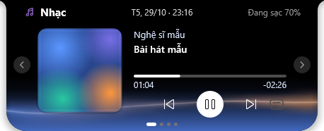
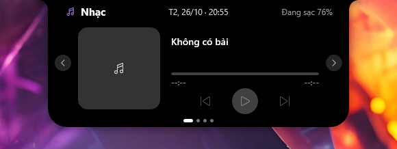
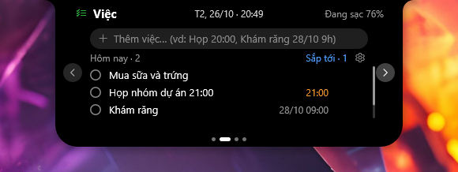
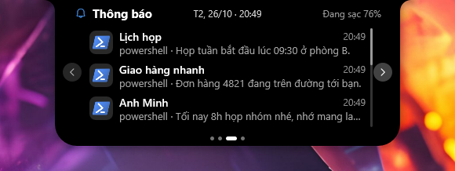
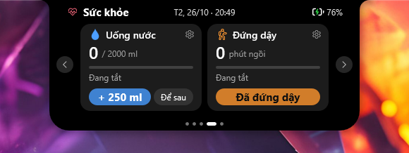
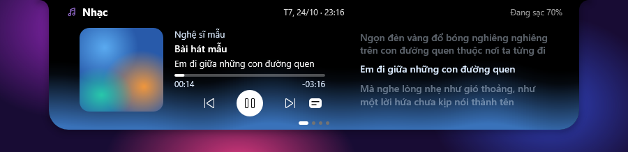
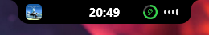

# PUW Notch

**Tiếng Việt** · [English](README.en.md)

Notch kiểu Dynamic Island cho Windows. Rust + Direct2D, exe ~523 KB, không WebView.

[](https://paypal.me/erikpuw)

## Tính năng

- **Notch**: giờ, vòng pin, sóng nhạc. Rê chuột để mở bảng. Tự thu mini khi viên thuốc (ngắn hay dài theo nhạc) đè lên tab hoặc chữ bên dưới, hiện lại khi hết, ẩn khi chơi game / xem phim toàn màn hình.
- **4 trang** (chuyển bằng ‹ ›):
  - **Nhạc**: ảnh bìa, lời bài hát (LRCLIB), ⏮ ⏯ ⏭, bấm để tua, nút lời bài hát giãn bảng ngang ra để xem lời chạy theo bài (dòng đang hát sáng ở giữa, dòng dài tự xuống dòng), nền trang Nhạc ngả dần sang màu ảnh bìa ở phía dưới khi đang phát, dải màu lượn sóng nhẹ. Hỗ trợ mọi app dùng media Windows, iTunes, foobar2000.
  - **Việc**: một danh sách cho cả việc và lịch hẹn. Gõ "Mua sữa", "Họp 20:00" (chỉ giờ = hôm nay) hay "Khám răng 28/10 14:30", "Gọi mẹ mai 9h" (có ngày = theo lịch). Tick / sửa / xóa; quá giờ chưa xong thì giữ lại, tô đỏ. ⚙ chọn nhắc trước 0–60 phút, luôn nhắc thêm đúng giờ.
  - **Thông báo**: đọc lại ~30 thông báo Windows gần nhất (mới nhất trên cùng, lăn chuột để cuộn), kèm icon của từng app.
  - **Sức khỏe**: nhắc uống nước và đứng dậy, chỉnh được giờ và mức.
- **Banner**: thông báo Windows, âm lượng, độ sáng, mic, Caps/Num Lock, Wi-Fi, Bluetooth, mạng, pin, tiết kiệm pin, thiết bị USB cắm và rút (kèm tên thiết bị). Icon dạng nét, mỗi icon chuyển động riêng.
- **Robot khi để yên**: không đụng máy 30 giây thì khuôn mặt LED (mắt + miệng) thay đồng hồ, nhìn quanh phía dưới, chớp mắt và đổi biểu cảm (tò mò, nháy mắt, phấn khích; hay cười khi đang sạc; buồn khi pin yếu); 5 phút thì ngủ, chữ z pixel bay lên; làm việc lại thì cười toe nhìn theo chuột, về giữa rồi trả về đồng hồ và pin. Bật / tắt ở tray.
- **Tray**: Notch tối giản, Robot khi để yên, Khởi động cùng Windows, Ngôn ngữ (Tiếng Việt / English), Giới thiệu PUW Notch (phiên bản, mô tả, liên kết GitHub), Thoát.

## Ảnh chụp

| | |
|---|---|
| <br>**Nhạc**: ảnh bìa, tên bài, lời, nền ngả theo màu ảnh bìa | <br>**Nhạc** khi chưa phát gì |
| <br>**Việc**: việc và lịch hẹn trong một danh sách | <br>**Thông báo**: kèm icon của từng app |
| <br>**Sức khỏe**: nhắc uống nước, đứng dậy | <br>**Banner** thông báo |

<br>**Nhạc** với lời bài hát: bảng giãn ngang, dòng đang hát sáng ở giữa

Viên thuốc thu gọn:

| Đang phát nhạc | Bình thường | Robot khi để yên | Robot vui |
|---|---|---|---|
|  |  |  |  |

## Build

```bash
cargo build --release
target/release/puw_notch.exe
```

Test: `cargo test`. Cài đặt lưu ở `%APPDATA%\PuwNotch\`.

Thông báo đọc từ trung tâm thông báo Windows, nên **thông báo Windows phải đang bật**. Muốn chỉ thấy thông báo trên notch, không hiện banner ở góc phải màn hình: bật **Không làm phiền** của Windows (Cài đặt → Hệ thống → Thông báo). Windows vẫn giữ thông báo trong trung tâm thông báo nên notch vẫn đọc và hiện banner như bình thường. Windows chưa cho app khác tự tắt banner của từng app đang chạy, nên việc này do bạn bật.

## Ủng hộ

Nếu PUW Notch có ích, mời tôi một ly cà phê ☕ [paypal.me/erikpuw](https://paypal.me/erikpuw)
