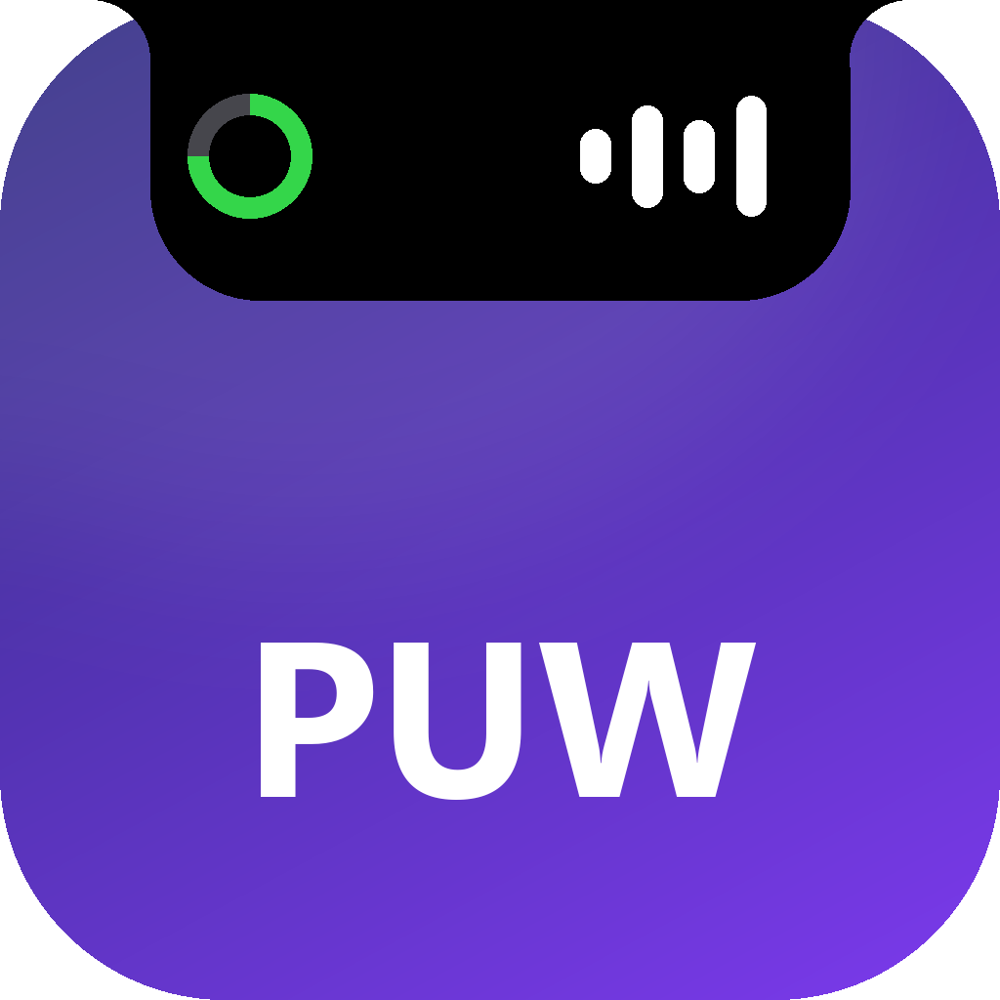

<p align="center">
  
</p>

<h1 align="center">PUW Notch</h1>

<p align="center"><b>Chiếc notch sống ngay trên Windows của bạn.</b></p>

<p align="center">
  Nhạc, việc, thông báo, thời tiết và một chú robot nhỏ, gói gọn ở mép trên màn hình theo kiểu Dynamic Island.<br>
  Rust + Direct2D vẽ trên GPU qua DirectComposition, exe ~664 KB, không WebView.
</p>

<p align="center"><b>Tiếng Việt</b> · <a href="README.en.md">English</a></p>

## Tính năng

- **Notch**: giờ, icon pin (3 nấc, sét xanh khi sạc, vàng khi tiết kiệm pin), sóng nhạc. Rê chuột để mở bảng. Tự thu mini khi đè lên tab hoặc chữ bên dưới (để đọc được phần dưới pill, notch không hiện khi quay hay chia sẻ màn hình; bấm PrtScn hoặc Win+Shift+S thì notch hiện trong ảnh chụp 30 giây); khi chơi game / xem phim toàn màn hình, thu mượt về mép trên rồi ẩn hẳn, thoát toàn màn hình thì bung lại.
- **5 trang** (chuyển bằng ‹ ›):
  - **Nhạc**: ảnh bìa, lời bài hát đồng bộ (LRCLIB), ⏮ ⏯ ⏭; bấm hoặc kéo thanh tiến độ để tua, xem trước thời gian khi kéo và gửi lệnh lúc thả. Hỗ trợ tua qua Windows media controls khi app cho phép, iTunes qua adapter riêng, foobar2000 qua seekbar của giao diện Default UI. App không hỗ trợ tua hoặc nguồn live không có thời lượng thì khóa thanh; đổi bài khi đang kéo sẽ hủy thao tác. Nút lời giãn bảng ngang để xem lời chạy theo bài; chọn câu sớm 80 ms và cuộn bằng lò xo độc lập với nhịp cập nhật nhạc, tua xa hoặc mở lại trang thì vào thẳng câu hiện tại. Nền và đường aurora theo màu ảnh bìa.
  - **Việc**: một danh sách cho việc và lịch hẹn. Gõ "Mua sữa", "Họp 20:00", "Khám răng 28/10 14:30", "Gọi mẹ mai 9h". Tick / sửa / xóa; quá giờ tô đỏ kèm "Trễ". ⚙ chọn nhắc trước 0–60 phút, luôn nhắc thêm đúng giờ.
  - **Thông báo**: ~30 thông báo Windows gần nhất kèm icon app; bấm một dòng để mở app đã gửi; cuộn mượt, nút "Xóa hết" ẩn các thông báo đã có (Windows vẫn giữ).
  - **Sức khỏe**: nhắc uống nước và đứng dậy, chỉnh được giờ và mức.
  - **Thời tiết**: gõ tên thành phố một lần (có dấu hay không đều được), viên thuốc hiện icon + nhiệt độ; trang có icon lớn, cảm nhận, độ ẩm, gió. °C | °F theo vùng Windows, bấm để đổi. Làm mới 30 phút ở luồng nền, quá 90 phút chuyển "cũ"; nút × tắt thời tiết.
- **Banner**: thông báo Windows, âm lượng, độ sáng, mic, Caps/Num Lock, Wi-Fi, Bluetooth, mạng, pin, tiết kiệm pin, USB cắm / rút. Chụp màn hình (Win+Shift+S) thì banner có ảnh thu nhỏ, bấm để mở ảnh.
- **Robot khi để yên**: 30 giây không đụng máy thì mặt LED thay đồng hồ, đổi biểu cảm; 5 phút thì ngủ; quay lại thì cười chào rồi trả về đồng hồ. Bật / tắt ở tray.
- **Tải theo phần đang hiện**: pill nhận bài mới, cập nhật ảnh bìa và chạy sóng nhạc giả lập khi đang phát. Mini chỉ giữ cache, không đọc metadata nhạc chi tiết hay bắt đầu tải ảnh bìa; bung lại pill thì cập nhật bài và bìa hiện tại. Đóng page thì giữ cache, ngừng tải lời bài hát và icon của page; mở lại thì dùng cache và sync trang đang xem. Lời chỉ tải khi mở trang Nhạc, icon thông báo chỉ tải khi mở trang Thông báo. Ẩn toàn màn hình thì ngừng đọc metadata nhạc chi tiết và không bắt đầu tải ảnh bìa hay lời. Chờ icon không giữ vòng vẽ chạy. Giờ, pin, thời tiết, phát hiện nội dung bị che, thông báo và nhắc việc vẫn cập nhật; yêu cầu tải đã chạy có thể hoàn tất vào cache.
- **Ẩn bảng âm lượng của Windows** (tray, mặc định tắt): app tự xử lý phím âm lượng nên chỉ notch hiện. Phím độ sáng và mic của laptop thường đi qua firmware nên chưa chặn được.
- **Tray**: Notch tối giản, Robot, Ẩn bảng âm lượng, Khởi động cùng Windows, Ngôn ngữ (Tiếng Việt / English), Giới thiệu, Thoát.

Ghi công: dữ liệu thời tiết [Open-Meteo](https://open-meteo.com) (CC BY 4.0), icon thời tiết và pin [Lucide](https://lucide.dev) (ISC), icon banner [Tabler Icons](https://tabler.io/icons) (MIT).
## Ảnh chụp

| | |
|---|---|
| <br>**Nhạc**: ảnh bìa, tên bài, lời, nền và đường aurora theo màu ảnh bìa | <br>**Nhạc** khi chưa phát gì |
| <br>**Việc**: việc và lịch hẹn trong một danh sách | <br>**Thông báo**: kèm icon của từng app |
| <br>**Sức khỏe**: nhắc uống nước, đứng dậy | <br>**Banner** thông báo |

<br>**Nhạc** với lời bài hát: bảng giãn ngang, dòng đang hát sáng ở giữa, đường aurora lượn dọc đáy bảng

<br>**Thời tiết**: icon lớn, nhiệt độ, nút °C | °F, cảm nhận, độ ẩm, gió

Viên thuốc thu gọn:

| Đang phát nhạc | Bình thường | Robot khi để yên | Robot vui |
|---|---|---|---|
|  |  |  |  |

Có thời tiết:

| Bình thường | Đang phát nhạc |
|---|---|
|  |  |

## Tải về và chạy

Tải `puw_notch.exe` ở mục [Releases](https://github.com/erikpuw/puw_notch/releases) rồi chạy. App chưa có chữ ký số nên Windows có thể chặn:

- **SmartScreen** ("Windows protected your PC"): bấm **More info** → **Run anyway**.
- **File bị đánh dấu tải từ mạng**: chuột phải vào file → **Properties** → tick **Unblock** → OK.
- **Smart App Control** (Windows 11, hiện "App blocked" và không có nút chạy tiếp): tắt ở Settings → Privacy & security → Windows Security → App & browser control → Smart App Control settings → **Off**. Tắt rồi không bật lại được nếu không cài lại Windows, nên cân nhắc. Cách khác là tự build từ mã nguồn (mục dưới), bản build trên máy mình thường chạy được.

## Build

```bash
cargo build --release
target/release/puw_notch.exe
```

`build.rs` gắn icon và thông tin phiên bản (VERSIONINFO: tên, công ty, version lấy từ `Cargo.toml`) vào exe, xem ở Properties → Details. Test: `cargo test`. Cài đặt lưu ở `%APPDATA%\PuwNotch\`. App ghi lúc khởi động, thoát, lỗi, lúc tự ẩn và GPU đang dùng để vẽ vào `%APPDATA%\PuwNotch\notch.log` (tối đa 64 KB, bắt đầu lại khi đổi phiên bản), để biết vì sao app không chạy khi khởi động cùng Windows.

Thông báo đọc từ trung tâm thông báo Windows, nên **thông báo Windows phải đang bật**. Muốn chỉ thấy thông báo trên notch, không hiện banner ở góc phải màn hình: bật **Không làm phiền** của Windows (Cài đặt → Hệ thống → Thông báo). Windows vẫn giữ thông báo trong trung tâm thông báo nên notch vẫn đọc và hiện banner như bình thường. Windows chưa cho app khác tự tắt banner của từng app đang chạy, nên việc này do bạn bật.

## Ủng hộ

Nếu PUW Notch có ích, mời tôi một ly cà phê ☕ [paypal.me/erikpuw](https://paypal.me/erikpuw)
